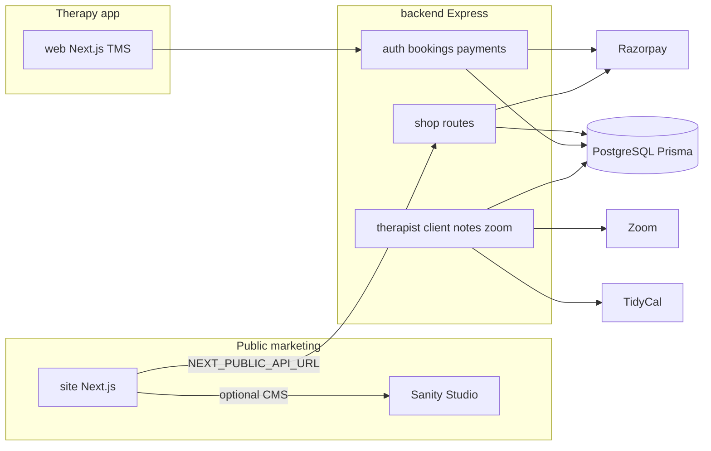

# Evolve with Avadhi (EWA) — Project history & handoff

**Repository:** https://github.com/pulkitarora-hub/EWA_Web_E-Shop  
**Latest notable commit (at time of writing):** `0c86f90` — *Add marketing site (Next.js), Sanity studio, and shop API with Razorpay* (2026-04-05)  
**Brand / domain:** [evolvewithavadhi.com](https://evolvewithavadhi.com) (WordPress being replaced by modern stack)  
**Built with:** Cursor (many commits tagged `Made-with: Cursor`)

---

## 1. What this repo is (two products, one monorepo)

The repo is **not only** the new marketing site. It contains **two related efforts**:

| Track | Folder(s) | Purpose | Status |
|--------|-----------|---------|--------|
| **A. Therapy Management System (TMS)** | `web/`, `backend/`, `mobile/` | Client/therapist/admin app: bookings, Razorpay session payments, encrypted notes, TidyCal + Zoom | Production-oriented; deployed on **Railway** (historically); documented in `FEATURES.md`, `CHANGELOG.md` |
| **B. Public marketing + merch e-shop** | `site/`, `studio/`, shop routes in `backend/` | Replace WordPress: marketing pages, blog, contact, shop + cart + Razorpay checkout | **Added April 2026**; works locally with API + DB; not necessarily deployed to production domain yet |

**Important for new contributors:** When setting up the application, clarify whether the goal is **TMS (`web`)**, **marketing site (`site`)**, or **both** sharing one `backend` and PostgreSQL.

---

## 2. Business goals (why this was built)

1. **Practice platform** — Clients book therapy, pay via Razorpay, join Zoom; therapists document sessions with encrypted notes; admins run the practice.
2. **Public website** — Modern, fast, editable marketing site aligned with live WordPress copy and purple EWA branding; optional **merch shop** with orders in the same backend DB.
3. **Editor experience** — **Sanity** for homepage, blog, and product merchandising content (with **fallback copy** in code when Sanity is not configured).
4. **Reduce WordPress dependency** — Static/SSR Next.js, structured content, integrated payments.

---

## 3. Repository layout (top level)

```
EWA_Web_E-Shop/
├── backend/          # Express + Prisma + PostgreSQL (sessions, bookings, shop, admin, etc.)
├── web/              # Next.js TMS client/therapist/admin UI (main therapy app)
├── site/             # Next.js 15 marketing + shop
├── studio/           # Sanity Studio schemas
├── mobile/           # Mobile app
├── docs/             # PLAN, SETUP, TESTING, PRODUCT_ROADMAP, PROJECT_HISTORY, notes/
├── FEATURES.md       # TMS product documentation (~v2.0)
├── CHANGELOG.md      # TMS v2.0 changelog
└── SECURITY_AUDIT.md
```

**Not in git:** `.env`, `.env.local`, `CREDENTIALS.md` (removed from repo after security audit), `Payment Analysis/` (ignored).

---

## 4. Chronological history

### Phase 0 — Onboarding / booking foundation (pre–March 2026)

- Monorepo started as **ewa_onboarding**: backend + web (+ mobile).
- Core flows: auth (email, Google, OTP), session catalog, Razorpay for **therapy** payments, bookings, admin, promos, referrals, email (Resend), SMS (MSG91).
- Session types seeded from policy (Clarity 45–90 min, Steady Inner Balance, Deep Work packages) with TidyCal URL mapping.
- Security: CSP, CORS via `ALLOWED_ORIGINS`, HSTS, etc.

### Phase 1 — Therapy Management System v2.0 (~2026-03-14)

**Major commit theme:** `feat: Therapy Management System v2.0` / `CHANGELOG.md` **[2.0.0]**

**Product:**

- Roles: `CLIENT`, `THERAPIST`, `ADMIN` with RBAC and role-based landing pages.
- **Therapist workspace:** today's sessions, clients, section-based note editor (observations, interventions, homework, private notes).
- **Client dashboard:** upcoming sessions + Zoom links, credits/subscription, journey timeline, shared notes only.
- **Therapy notes:** AES-256-GCM at rest; sharing controls; audit logging.
- **TidyCal:** cron sync every 5 minutes → booking `meetingUrl`, actual times, `tidycalBookingId`.
- **Zoom:** S2S OAuth, webhooks, admin config panel (recordings infrastructure).

**Tech:**

- New Prisma models: `TherapistProfile`, `ClientProfile`, `TherapyNote`, attachments/tags, `ZoomConfig`, `ZoomMeeting`, `ZoomRecording`.
- New routes: `therapist`, `clientProfile`, `therapyNotes`, `zoom`, `adminTherapist`.
- Services: `tidycal.ts`, `zoom.ts`, `encryption.ts`.
- Frontend: `TherapistDashboard`, `ClientDashboard`, redesigned `AdminDashboard`.

**Docs added:** `FEATURES.md`, `docs/PRODUCT_ROADMAP.md` (36 built features, partials, roadmap).

### Phase 2 — PWA, then production firefighting (2026-03-14, same day)

- **PWA added:** manifest, icons, `PWAInstallPrompt`, responsive dashboards.
- **Service worker removed** after it caused stale Next.js bundles and **"Failed to find Server Action"** after Railway deploys.
- **Caching fixes:** `force-dynamic` on root page; later SW cleanup script in layout to unregister old SWs in users' browsers.
- **Railway / DB:** Missing TidyCal columns on production → migration + `ensure-schema` pre-migration script; `trust proxy` for rate limit; `Promise.allSettled` on admin overview so one failing query doesn't break analytics.
- **Security hardening pass:** strip `passwordHash` from API responses, protect admin seed, timing-safe Razorpay/Zoom signatures, rate limits, stronger passwords, headers; dependency patches; `SECURITY_AUDIT.md`; **deleted `CREDENTIALS.md`** from repo.

### Phase 3 — Client/admin polish (2026-03-15)

- Client **Invoices** and **My Notes** pages.
- Admin **Sessions CRUD** (`adminSessions.ts`).
- Single admin role logic (`role === ADMIN` only).

### Phase 4 — WordPress replacement + e-shop (2026-04-05)

**Goal:** Modern public site for Evolve with Avadhi + merch shop, sharing backend payments stack.

**`site/` (Next.js 15 App Router):**

- Pages: `/`, `/about`, `/services`, `/blog`, `/blog/[slug]`, `/contact`, `/shop`, `/shop/[slug]`, `/cart`, `/checkout`, `/checkout/success`.
- SEO: `sitemap.ts`, `robots.ts`; redirect `/enquiry-now` → `/contact` (in next config).
- **Content:** `site/src/lib/siteContent.ts` (`FALLBACK_HOME`, full About, core values, oath); `getSiteContent.ts` merges Sanity `homePage` or fallback.
- **Hero:** two rotating slides (synced from live site); testimonial **Nicole Kepling** (not Nada on homepage).
- **Header/footer:** `bg-eva-royal`, centered logo (like WordPress), dark/light logos in `public/images/`.
- **Images:** real photos, certs, `avadhi-signature-midnight.png` (recolored + transparent PNG).
- **Shop:** products from `GET {API}/shop/products`; cart in `localStorage`; checkout loads Razorpay script; create/verify via backend.
- **Sanity:** `@sanity/client` only (**not** `next-sanity` — broke dev with `motion` export).
- **Revalidate:** `/api/revalidate` for webhook-style ISR (when Sanity configured).
- **Blog:** Portable Text component + fallback bodies in `blogFallbackBodies.ts`; script `site/scripts/import-blog-to-sanity.mjs`.

**`studio/` (Sanity):**

- Documents: `siteSettings`, `homePage`, `post`, `productMerch`.
- `.env.example` for project ID/dataset.

**`backend/` shop extension:**

- Models: `ShopProduct`, `ShopOrder`, `ShopOrderItem`.
- Migration: `20260404161444_add_shop_models`.
- `backend/src/routes/shop.ts`:
  - `GET /shop/products`
  - `POST /shop/checkout/create` → Prisma order + Razorpay order
  - `POST /shop/checkout/verify` → HMAC verify (timing-safe), mark paid, decrement stock
- Auto-seed shop products on startup (when implemented in `index.ts`).
- Mounted on same Express app as TMS.

**Content sync decisions (from live WordPress):**

- Dual hero headlines.
- Full About (mission, long bio, education/certs, values, oath).
- **Removed Nada Academy block from homepage** (no longer on live homepage).
- `NadaSection.tsx` may still exist but not used on home.

**Local dev notes from testing:**

- Site often run on **port 3002** if 3000 busy.
- `NEXT_PUBLIC_API_URL=http://localhost:4000`.
- Corrupt `.next` → delete `.next` and restart.
- Backend + migrate + Razorpay keys required for full checkout test.

**Git publish:**

- Repo: **pulkitarora-hub/EWA_Web_E-Shop**, branch `main`.

---

## 5. Architecture (how pieces connect)



---

## 6. Environment variables (cheat sheet)

**Backend (therapy + shop):** see `backend/.env.example`  
Includes: `DATABASE_URL`, `JWT_SECRET`, `RAZORPAY_KEY_ID`, `RAZORPAY_KEY_SECRET`, `TIDYCAL_API_TOKEN`, Zoom vars, `NOTES_ENCRYPTION_KEY`, email/SMS, `ALLOWED_ORIGINS`, etc.

**`site/.env.local` (typical):**

```env
NEXT_PUBLIC_API_URL=http://localhost:4000
NEXT_PUBLIC_SANITY_PROJECT_ID=   # optional
NEXT_PUBLIC_SANITY_DATASET=production
SANITY_REVALIDATE_SECRET=        # for /api/revalidate
```

**`studio/`:** copy `.env.example` → Sanity project ID, dataset.

**Never commit:** production secrets; rotate if they ever lived in `CREDENTIALS.md`.

---

## 7. How to run locally (minimal)

```bash
# 1) Database + API
cd backend
cp .env.example .env   # fill in
npm install
npx prisma migrate dev
npm run dev            # default :4000

# 2) Marketing site
cd site
# create .env.local from section 6
npm install
npm run dev            # :3000 or 3002

# 3) Sanity Studio (optional)
cd studio
npm install
npm run dev
```

**TMS app:** `cd web && npm install && npm run dev` (point at same API URL as configured for web).

---

## 8. Test accounts (TMS — from CHANGELOG; rotate in prod)

| Email | Password | Role |
|--------|----------|------|
| test@evolve.com | test1234 | ADMIN |
| manvi@admin.com | test1234 | CLIENT |
| therapistavadhi@test.com | test1234 | THERAPIST |

Treat as **dev-only**; do not assume still valid in production.

---

## 9. Known issues & intentional decisions

| Topic | Decision / issue |
|--------|------------------|
| PWA service worker | **Removed** — caused stale deploys; install prompt kept; SW cleanup in layout for existing users |
| Production schema drift | `ensure-schema` + defensive admin queries (`select` not `include` on fragile columns) |
| Sanity on marketing site | **Optional** — site works fully on `FALLBACK_HOME` + static blog fallbacks |
| `next-sanity` | **Avoid** — use `@sanity/client` |
| Two Next apps | `web` = logged-in TMS; `site` = public marketing — don't merge without a plan |
| Shop vs session payments | Same Razorpay keys; different DB tables (`ShopOrder` vs booking payments) |
| Repo name | `EWA_Web_E-Shop` but includes full TMS history from `ewa_onboarding` |

---

## 10. What is **not** done / likely next steps

- Deploy **`site/`** to production (Vercel/Cloudflare) and point **evolvewithavadhi.com** away from WordPress.
- Wire Sanity production project + webhook → `/api/revalidate`.
- Admin UI for **shop orders** (API exists; may need admin screens).
- Unify or document **single deployment** story for `web` vs `site` vs `backend`.
- Merch catalog: CMS (`productMerch`) vs DB (`ShopProduct`) — clarify single source of truth.
- Mobile app alignment with v2.0 roles/notes (verify `mobile/` against current API).
- Items in `docs/PRODUCT_ROADMAP.md` (partial features + future phases).

---

## 11. Files to read first

| File | Why |
|------|-----|
| `docs/SETUP.md`, `docs/TESTING.md` | Original monorepo setup |
| `docs/PRODUCT_ROADMAP.md` | Feature matrix and file map |
| `FEATURES.md` | TMS capabilities |
| `CHANGELOG.md` | TMS v2.0 detail |
| `SECURITY_AUDIT.md` | Security work already done |
| `site/src/lib/siteContent.ts` | Marketing copy source of truth (fallback) |
| `site/src/lib/getSiteContent.ts` | Sanity merge logic |
| `backend/src/routes/shop.ts` | E-shop API |
| `backend/prisma/schema.prisma` | All models |

---

## 12. Suggested AI assistant prompt (starter)

> You are helping on **Evolve with Avadhi**. Repo: `pulkitarora-hub/EWA_Web_E-Shop`. Monorepo: `backend` (Express/Prisma), `web` (therapy TMS), `site` (public marketing + shop), `studio` (Sanity). Latest work added `site` + `studio` + shop API to replace WordPress. Prefer minimal diffs; match existing patterns; never commit secrets. For marketing copy, check Sanity first, then `site/src/lib/siteContent.ts`. For payments, Razorpay with timing-safe verification. Read `docs/PROJECT_HISTORY.md` and `FEATURES.md` before large changes.

---

## 13. Clone checklist (new machine)

1. `git clone https://github.com/pulkitarora-hub/EWA_Web_E-Shop.git`
2. Backend `.env` + PostgreSQL + `prisma migrate dev`
3. Razorpay test keys for shop checkout
4. `site/.env.local` with `NEXT_PUBLIC_API_URL`
5. Optional Sanity vars + run `studio`
6. Decide target: **TMS (`web`)** vs **marketing (`site`)** for the task at hand
